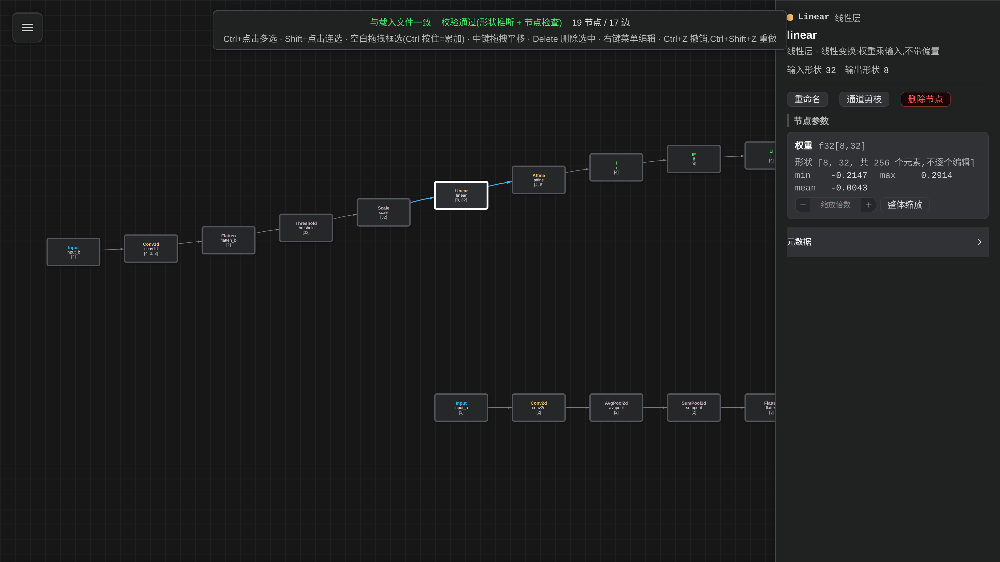

# spikevis（nir-visualizer）

NIR（神经形态中间表示）模型的查看与编辑器，在浏览器里打开 `.nir` 文件，直接看结构、改参数，再无损存回去。



在线使用：**[https://mini-mind.github.io/spikevis/](https://mini-mind.github.io/spikevis/)** —— 无需安装，文件只在你的浏览器里处理，不上传。

## 功能

- 📊 **模型可视化**: 将 NIR 模型显示为网络图，节点标出类型与形状
- 📋 **节点详情**: 点击节点查看并编辑参数
- ✏️ **画布编辑**: 新建节点、连线、断开、重命名、删除，支持撤销重做
- 📦 **成组与子图**: 把多个节点编成一组，双击进入子图内部继续编辑
- ✂️ **通道剪枝**: 裁掉一部分通道，上下游节点的权重自动联动
- 🌐 **中英双语**: 菜单里一键切换
- 💾 **无损读写**: 存回的 `.nir` 与官方 Python 库兼容，没改动的数据逐位不变

## 使用方法

在线版直接打开网页即可。本地运行：

```bash
npm install
npm run dev
```

打开浏览器访问 `http://localhost:5173`，点击“打开模型”选择 `.nir` 文件（旧版 `.json` 模型只能查看）。

## 更多

功能细节、校验与导出规则、测试方法、代码结构见 [docs/DETAILS.md](docs/DETAILS.md)。

## 许可证

MIT，见 [LICENSE](LICENSE)。
